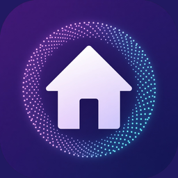
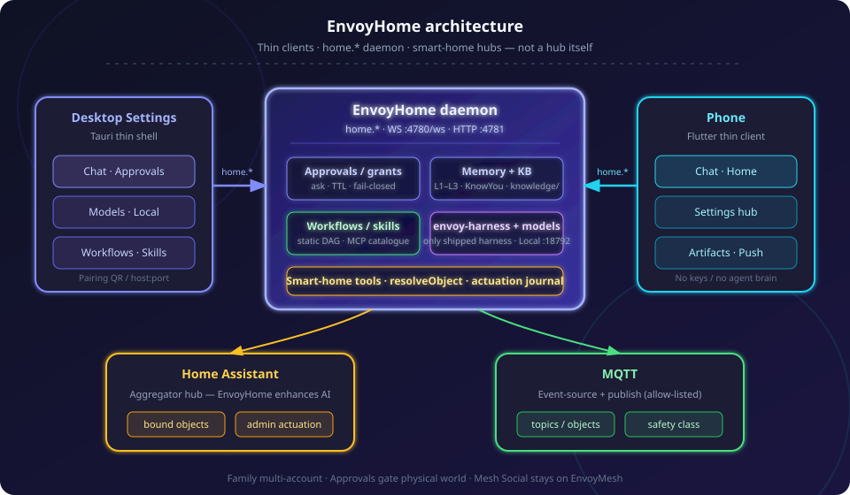
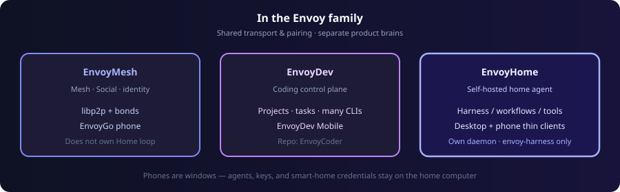

<p align="center">
  
</p>

<p align="center">
  <strong>EnvoyHome — Self-hosted home agent control plane</strong>
</p>

<p align="center">
  
  
  
  
</p>

<p align="center">
  <a href="#getting-started">⬇ Getting started</a>
  ·
  <strong>English</strong>
  ·
  <a href="README.zh-CN.md">简体中文</a>
</p>

# EnvoyHome

**A security-first home agent you run on your own computer.**

EnvoyHome is the **household brain** in the [EnvoyMesh](https://github.com/allenpeng0705/EnvoyMesh) apps group: chat, memory, static workflows, skills, Approvals, and a **smart-home surface** (Home Assistant + MQTT) — without becoming a hub itself, and without shipping EnvoyMesh Social feeds.

- **Your home computer runs the daemon** — thin clients (desktop Settings shell + Flutter phone) dial `home.*` over the EnvoyMesh super channel.
- **Family multi-account** — one agent, isolated profiles (memory, files, policy); phones pair to the house, not to a cloud account.
- **Approvals & grants** — durable ask/TTL/fail-closed; actuation is `admin`; safety-class objects never ride a grant.
- **Smart home is Core** — enhance AI for Home Assistant / MQTT; integrate with hubs, do not replace them.
- **Local-first models** — cloud providers or EnvoyHome Local / Ollama; Home chat `:18792`, Home embed `:18793` (never Mesh Local attach).
- **Same family as EnvoyDev** — pairing / dial ladder patterns from [EnvoyCoder](https://github.com/allenpeng0705/EnvoyCoder); coding IDE stays EnvoyDev’s job.

📖 **[QuickStart.md](QuickStart.md)** — daemon, desktop, and phone in minutes.

<p align="center">
  
</p>
<p align="center"><em>Desktop Settings + phone dial the home daemon over <code>home.*</code>; smart-home hubs stay external.</em></p>

---

## Table of contents

- [What can it do?](#what-can-it-do)
- [How it works](#how-it-works)
- [In the Envoy family](#in-the-envoy-family)
- [Getting started](#getting-started)
- [Project structure](#project-structure)
- [Design docs](#design-docs)
- [Current status](#current-status)
- [Want to read more?](#want-to-read-more)
- [License](#license)

---

## What can it do?

### Surfaces

| Surface | Path | Role |
|---------|------|------|
| **Daemon** | `packages/daemon` | Control plane — WS `:4780/ws`, HTTP `:4781` |
| **Desktop** | `apps/desktop` | Tauri Settings shell (Chat, Pairing, Approvals, Models, Local, Connections, Skills / Workflows / Schedules, …) |
| **Mobile** | `apps/mobile` | Flutter thin client — QR / `host:port` / SSH hop into the same `home.*` channel |
| **Branding** | `apps/branding` | Product mark + store icon pack |

Product order for live demos: **desktop → phone → optional IM last**.

### Home agent

- **Chat with memory** — standing L1–L3, gated PendingLearn, Doc KB (`knowledge/`) + KnowYou; path-jailed files and artifacts.
- **Static workflows** — Diagram \| YAML dual editor, NL draft, tool catalogue (builtins, skills, HA/MQTT, Owner MCP `mcp__…`).
- **Schedules** — NL WHEN → propose → confirm; reminders and workflow/tool payloads.
- **Skills** — verify-then-enable packs; progressive disclosure tools (`skills_list` / `skill_view` / `skill_propose`).
- **Web & browser** — `web_search` / `web_extract` / `web_research`, managed Chromium / Obscura, form cards (never solve CAPTCHAs).
- **Office pipeline** — `extract_document` / `export_document` / `promote_knowledge` (optional LibreOffice for print quality).

### Smart home

- **Home Assistant + MQTT** — bind objects, resolve through `objectId`, journaled actuation.
- **Safety-first** — data-driven safety **class** (unknown ⇒ deny); unlock / garage / valve / disarm never grant-covered.
- Guides: [`docs/smart-home.md`](docs/smart-home.md) · [`docs/homeassistant-setup.md`](docs/homeassistant-setup.md) · [`docs/mqtt-setup.md`](docs/mqtt-setup.md)

⚠️ Actuation tools (`ha_call_service`, `mqtt_publish`) are **`admin`**. Unattended runs need a grant. Presence-revealing state does not auto-enter standing memory.

---

## How it works

```
  Desktop Settings                 EnvoyHome daemon                    Phone
  ┌──────────────┐   home.*       ┌────────────────────┐  home.*    ┌──────────────┐
  │ Tauri shell  │◀──────────────▶│ Approvals · Memory │◀──────────▶│ Flutter thin │
  │ Chat / Ops   │  WS :4780/ws   │ Workflows · Models │  pair QR   │ client       │
  └──────────────┘                │ Smart-home tools   │            └──────────────┘
                                  └─────────┬──────────┘
                                            │ objectId + journal
                               ┌────────────┴────────────┐
                               ▼                         ▼
                        Home Assistant                  MQTT
                        (aggregator hub)           (event-source)
```

- **Peers on the wire** speak `home.*` JSON-RPC (EnvoyMesh-hosted envelope). Relays / mesh help reachability; the household agent loop lives in **this** daemon.
- **Thin clients** never hold provider keys, HA tokens, or the agent brain — pair once, then remote the Settings / Chat UI.
- **Hubs stay hubs** — EnvoyHome resolves bound objects and gates actuation; it does not replace HA’s device graph.

Full diagram: [`docs/screens/envoyhome-architecture.svg`](docs/screens/envoyhome-architecture.svg).

---

## In the Envoy family

EnvoyHome reuses EnvoyMesh transport and EnvoyDev-style thin-client patterns — it does **not** fork `@envoymesh/*`, and it does **not** ship Mesh Social.

<p align="center">
  
</p>
<p align="center"><em>Shared pairing / dial ladder — separate product brains.</em></p>

| Product | Job | Brain |
|---------|-----|-------|
| **[EnvoyMesh](https://github.com/allenpeng0705/EnvoyMesh)** | Mesh identity, bonds, Social, optional Ext Agent | Does not own EnvoyHome’s agent loop |
| **[EnvoyDev](https://github.com/allenpeng0705/EnvoyCoder)** | Coding-agent control plane | Coding agents / envoy-harness |
| **EnvoyHome** (this repo) | Home assistant: chat, memory, workflows, smart home, multi-account | **Own daemon** + harness plugins |
| **EnvoyGo / thin clients** | Phone / paired UI | Dial product daemon — no brain on the phone |

Sibling layout (linked with `link:`, not npm):

```text
parent/
  EnvoyHome/       ← this repo
  EnvoyMesh/       ← @envoymesh/* (required)
  envoy-harness/   ← default harness (desktop may pin-fetch)
  EnvoyCoder/      ← reference patterns only (optional)
```

---

## Getting started

**Hands-on walkthrough:** [`QuickStart.md`](QuickStart.md).

```bash
# Fail-closed sibling check (or set ENVOYHOME_PEERS_GIT_BASE and ./scripts/fetch-peers.sh)
./scripts/peers-check.sh

# Never install with CI=true (pnpm strict-mode trap — conventions R9)
env -u CI pnpm install

./scripts/ci.sh                   # docs-lint → peers → install → build → test → lint
pnpm desktop:dev                  # build daemon if needed → Tauri Settings
pnpm version:desktop -- 0.1.0     # bump desktop VERSION (see scripts/README.md)
./scripts/build-desktop.sh macos  # DMG → release/ (Linux: linux; Windows: .\scripts\build-desktop.ps1)
```

Ports (Design §2.4): WebSocket `4780` at `/ws`, HTTP `4781` (`GET /health`).

Mobile:

```bash
cd apps/mobile
flutter pub get
flutter run    # pair via desktop Pairing QR / host:port / SSH hop
```

---

## Project structure

```text
EnvoyHome/
├── apps/
│   ├── desktop/     # Tauri Settings shell
│   ├── mobile/      # Flutter thin client
│   └── branding/    # Mark + store icons
├── packages/
│   ├── daemon/      # Control plane (home.*)
│   ├── protocol/    # @envoyhome/protocol
│   ├── harness-host/
│   ├── memory/
│   ├── workflows/
│   ├── providers/
│   ├── channel-api/
│   ├── smarthome/    # HA + MQTT tools
│   └── …
├── plugins/         # Chat + event-source channel plugins
├── design_doc/      # Design + Memory + Knowledge-RAG + Implementation Plan
├── docs/            # Operator guides (smart home, mobile, …)
├── QuickStart.md
└── AGENTS.md
```

---

## Design docs

| Doc | Role |
|-----|------|
| [`design_doc/EnvoyHome-Design.md`](design_doc/EnvoyHome-Design.md) | **Ground truth** — Normative product + security |
| [`design_doc/EnvoyHome-Memory-Design.md`](design_doc/EnvoyHome-Memory-Design.md) | Memory layers L0–L7, flush, LearnQueue |
| [`design_doc/EnvoyHome-Knowledge-RAG-Design.md`](design_doc/EnvoyHome-Knowledge-RAG-Design.md) | Doc KB + KnowYou + Home embed `:18793` |
| [`design_doc/EnvoyHome-Implementation-Plan.md`](design_doc/EnvoyHome-Implementation-Plan.md) | Build Stages **B0–B14**, verification IDs |
| [`tests/min/conventions.md`](tests/min/conventions.md) | Rules **R1–R13** (read before package edits) |
| [`AGENTS.md`](AGENTS.md) | Instructions for AI coding agents |

---

## Current status

Spine **B0–B14** is on `main`. Design gate **G1** and plan gate **G6** are accepted. **`v1.0.0` is not tagged yet** — see Plan release bar (§8) and the early-adopter claim sheet:

[`design_doc/reviews/2026-10-22-early-adopter-claims.md`](design_doc/reviews/2026-10-22-early-adopter-claims.md)

Preview posture: desktop + phone + HA/MQTT **demo/fixture**. Do **not** claim Privacy Mode as a finished product toggle, a production IM zoo, or agentskills.io conformance until those bars close. Mobile live verify: [`docs/mobile-live-verify.md`](docs/mobile-live-verify.md).

Branding / store pack: [`apps/branding/store/README.md`](apps/branding/store/README.md).

---

## Want to read more?

- **Start here:** [`QuickStart.md`](QuickStart.md)
- **Diagrams:** [`docs/screens/`](docs/screens/) (logo · architecture · family)
- **Smart home:** [`docs/smart-home.md`](docs/smart-home.md) · HA · MQTT · [live checklist](docs/smart-home-live-checklist.md)
- **Mobile:** [`apps/mobile/README.md`](apps/mobile/README.md) · [`docs/mobile-live-verify.md`](docs/mobile-live-verify.md) · [iOS/Android setup](docs/mobile-ios-android-setup.md)
- **Desktop:** [`apps/desktop/README.md`](apps/desktop/README.md) · [`scripts/README.md`](scripts/README.md)
- **Family peers:** [EnvoyMesh](https://github.com/allenpeng0705/EnvoyMesh) · [EnvoyDev / EnvoyCoder](https://github.com/allenpeng0705/EnvoyCoder) · [envoy-harness](https://github.com/allenpeng0705/envoy-harness)
- **Website (family):** [www.envoymesh.cn](https://www.envoymesh.cn)

---

## License

[Apache License 2.0](LICENSE)
