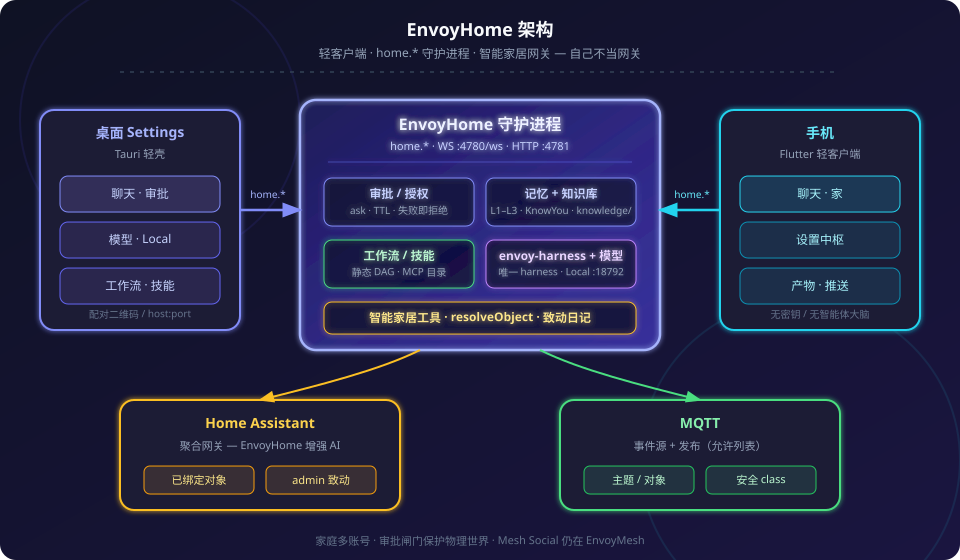

<p align="center">
  
</p>

<p align="center">
  <strong>EnvoyHome — 自托管家庭智能体控制平面</strong>
</p>

<p align="center">
  
  
  
  
</p>

<p align="center">
  <a href="#快速开始">⬇ 快速开始</a>
  ·
  <a href="README.md">English</a>
  ·
  <strong>简体中文</strong>
</p>

# EnvoyHome

**跑在你家电脑上的、安全优先的家庭智能体。**

EnvoyHome 是 [EnvoyMesh](https://github.com/allenpeng0705/EnvoyMesh) 应用族里的**家庭大脑**：聊天、记忆、静态工作流、技能、审批，以及 **智能家居面**（Home Assistant + MQTT）——自己不当网关，也不承载 EnvoyMesh Social 动态流。

- **家用电脑跑守护进程** — 轻客户端（桌面 Settings 壳 + Flutter 手机）通过 EnvoyMesh 超级通道拨入 `home.*`。
- **家庭多账号** — 一套智能体、隔离的档案（记忆 / 文件 / 策略）；手机配对的是「这套家」，不是云账号。
- **审批与授权** — 持久 ask / TTL / 失败即拒绝；致动为 `admin`；安全类对象永不被 grant 覆盖。
- **智能家居是 Core** — 增强 HA / MQTT 上的 AI；对接网关，不替代网关。
- **本地优先模型** — 云厂商或 EnvoyHome Local / Ollama；Home 聊天 `:18792`、Home 向量 `:18793`（永不 attach Mesh Local）。
- **与 EnvoyDev 同族** — 配对 / 拨号阶梯参考 [EnvoyCoder](https://github.com/allenpeng0705/EnvoyCoder)；编程 IDE 仍归 EnvoyDev。

📖 **[QuickStart.md](QuickStart.md)** — 几分钟跑起守护进程、桌面与手机。

<p align="center">
  
</p>
<p align="center"><em>桌面 Settings + 手机通过 <code>home.*</code> 拨入家用守护进程；智能家居网关仍在外部。</em></p>

---

## 目录

- [能做什么？](#能做什么)
- [工作原理](#工作原理)
- [在 Envoy 应用族中的位置](#在-envoy-应用族中的位置)
- [快速开始](#快速开始)
- [项目结构](#项目结构)
- [设计文档](#设计文档)
- [当前状态](#当前状态)
- [更多阅读](#更多阅读)
- [许可证](#许可证)

---

## 能做什么？

### 产品面

| 面 | 路径 | 职责 |
|----|------|------|
| **守护进程** | `packages/daemon` | 控制平面 — WS `:4780/ws`，HTTP `:4781` |
| **桌面** | `apps/desktop` | Tauri Settings 壳（聊天、配对、审批、模型、Local、连接、技能 / 工作流 / 计划任务…） |
| **手机** | `apps/mobile` | Flutter 轻客户端 — 扫码 / `host:port` / SSH 跳板进入同一 `home.*` |
| **品牌** | `apps/branding` | 产品标识与商店图标包 |

现场演示顺序：**桌面 → 手机 → 可选 IM 最后**。

### 家庭智能体

- **带记忆的聊天** — 常驻 L1–L3、门控 PendingLearn、Doc KB（`knowledge/`）+ KnowYou；路径沙箱与产物。
- **静态工作流** — 图解 \| YAML 双模编辑、自然语言草稿、工具目录（内置、技能、HA/MQTT、Owner MCP `mcp__…`）。
- **计划任务** — 自然语言 WHEN → 提议 → 确认；提醒与工作流 / 工具载荷。
- **技能** — 先校验再启用；渐进披露工具（`skills_list` / `skill_view` / `skill_propose`）。
- **网页与浏览器** — `web_search` / `web_extract` / `web_research`，托管 Chromium / Obscura，表单卡片（永不破解验证码）。
- **办公管线** — `extract_document` / `export_document` / `promote_knowledge`（可选 LibreOffice 打印级导出）。

### 智能家居

- **Home Assistant + MQTT** — 绑定对象、经 `objectId` 解析、有日记的致动。
- **安全优先** — 数据驱动的安全 **class**（未知即拒绝）；开锁 / 车库 / 阀门 / 撤防等永不被 grant 覆盖。
- 指南：[`docs/smart-home.md`](docs/smart-home.md) · [`docs/homeassistant-setup.md`](docs/homeassistant-setup.md) · [`docs/mqtt-setup.md`](docs/mqtt-setup.md)

⚠️ 致动工具（`ha_call_service`、`mqtt_publish`）为 **`admin`**。无人值守需 grant。暴露存在感的状态不会自动进入常驻记忆。

---

## 工作原理

```
  桌面 Settings                    EnvoyHome 守护进程                    手机
  ┌──────────────┐   home.*       ┌────────────────────┐  home.*    ┌──────────────┐
  │ Tauri 壳     │◀──────────────▶│ 审批 · 记忆        │◀──────────▶│ Flutter 轻   │
  │ 聊天 / 运维  │  WS :4780/ws   │ 工作流 · 模型      │  扫码配对  │ 客户端       │
  └──────────────┘                │ 智能家居工具       │            └──────────────┘
                                  └─────────┬──────────┘
                                            │ objectId + 日记
                               ┌────────────┴────────────┐
                               ▼                         ▼
                        Home Assistant                  MQTT
                        （聚合网关）                   （事件源）
```

- **线路上的对等方**讲 `home.*` JSON-RPC（由 EnvoyMesh 托管信封）。中继 / mesh 帮助可达性；家庭智能体循环落在**本**守护进程。
- **轻客户端**从不持有厂商密钥、HA token 或智能体大脑 — 配对一次，即可远程 Settings / 聊天 UI。
- **网关仍是网关** — EnvoyHome 解析已绑定对象并闸门致动；不替代 HA 的设备图。

完整图：[`docs/screens/envoyhome-architecture-zh.svg`](docs/screens/envoyhome-architecture-zh.svg)。

---

## 在 Envoy 应用族中的位置

EnvoyHome 复用 EnvoyMesh 传输与 EnvoyDev 风格的轻客户端模式——**不** fork `@envoymesh/*`，也**不**交付 Mesh Social。

<p align="center">
  
</p>
<p align="center"><em>共享配对 / 拨号阶梯 — 产品大脑各自独立。</em></p>

| 产品 | 职责 | 「大脑」 |
|------|------|----------|
| **[EnvoyMesh](https://github.com/allenpeng0705/EnvoyMesh)** | Mesh 身份、建联、Social、可选 Ext Agent | 不拥有 EnvoyHome 的智能体循环 |
| **[EnvoyDev](https://github.com/allenpeng0705/EnvoyCoder)** | 编程代理控制平面 | 编程代理 / envoy-harness |
| **EnvoyHome**（本仓库） | 家庭助手：聊天、记忆、工作流、智能家居、多账号 | **自有守护进程** + harness 插件 |
| **EnvoyGo / 轻客户端** | 手机 / 已配对 UI | 拨入产品守护进程 — 手机上无大脑 |

并列目录（`link:` 链接，不上 npm）：

```text
parent/
  EnvoyHome/       ← 本仓库
  EnvoyMesh/       ← @envoymesh/*（必需）
  envoy-harness/   ← 默认 harness（桌面可按 pin 拉取）
  EnvoyCoder/      ← 仅参考模式（可选）
```

---

## 快速开始

**动手步骤：** [`QuickStart.md`](QuickStart.md)。

```bash
# 失败即退出的并列仓库检查（或设置 ENVOYHOME_PEERS_GIT_BASE 后 ./scripts/fetch-peers.sh）
./scripts/peers-check.sh

# 切勿在 CI=true 下安装（pnpm 严格模式陷阱 — 约定 R9）
env -u CI pnpm install

./scripts/ci.sh                   # docs-lint → peers → install → build → test → lint
pnpm desktop:dev                  # 必要时构建守护进程 → Tauri Settings
pnpm version:desktop -- 0.1.0     # bump 桌面 VERSION（见 scripts/README.md）
./scripts/build-desktop.sh macos  # DMG → release/（Linux: linux；Windows: .\scripts\build-desktop.ps1）
```

端口（设计 §2.4）：WebSocket `4780` 路径 `/ws`，HTTP `4781`（`GET /health`）。

手机：

```bash
cd apps/mobile
flutter pub get
flutter run    # 经桌面「配对」扫码 / host:port / SSH 跳板
```

---

## 项目结构

```text
EnvoyHome/
├── apps/
│   ├── desktop/     # Tauri Settings 壳
│   ├── mobile/      # Flutter 轻客户端
│   └── branding/    # 标识与商店图标
├── packages/
│   ├── daemon/      # 控制平面（home.*）
│   ├── protocol/    # @envoyhome/protocol
│   ├── harness-host/
│   ├── memory/
│   ├── workflows/
│   ├── providers/
│   ├── channel-api/
│   ├── smarthome/    # HA + MQTT 工具
│   └── …
├── plugins/         # 聊天与事件源通道插件
├── design_doc/      # 设计 + 记忆 + Knowledge-RAG + 实施计划
├── docs/            # 运维指南（智能家居、手机…）
├── QuickStart.md
└── AGENTS.md
```

---

## 设计文档

| 文档 | 角色 |
|------|------|
| [`design_doc/EnvoyHome-Design.md`](design_doc/EnvoyHome-Design.md) | **事实来源** — 规范性产品与安全 |
| [`design_doc/EnvoyHome-Memory-Design.md`](design_doc/EnvoyHome-Memory-Design.md) | 记忆层 L0–L7、flush、LearnQueue |
| [`design_doc/EnvoyHome-Knowledge-RAG-Design.md`](design_doc/EnvoyHome-Knowledge-RAG-Design.md) | Doc KB + KnowYou + Home 向量 `:18793` |
| [`design_doc/EnvoyHome-Implementation-Plan.md`](design_doc/EnvoyHome-Implementation-Plan.md) | 构建阶段 **B0–B14**、验证 ID |
| [`tests/min/conventions.md`](tests/min/conventions.md) | 规则 **R1–R13**（改包代码前必读） |
| [`AGENTS.md`](AGENTS.md) | AI 编程代理说明 |

---

## 当前状态

脊柱 **B0–B14** 已在 `main`。设计门 **G1** 与计划门 **G6** 已接受。**尚未打 `v1.0.0` 标签** — 见计划发布门槛（§8）与早期用户声明表：

[`design_doc/reviews/2026-10-22-early-adopter-claims.md`](design_doc/reviews/2026-10-22-early-adopter-claims.md)

预览姿态：桌面 + 手机 + HA/MQTT **演示 / 夹具**。在对应门槛关闭前，**不要**宣称 Privacy Mode 为成品开关、生产级 IM 动物园，或 agentskills.io 符合性。手机实地验证：[`docs/mobile-live-verify.md`](docs/mobile-live-verify.md)。

品牌 / 商店包：[`apps/branding/store/README.md`](apps/branding/store/README.md)。

---

## 更多阅读

- **从这里开始：** [`QuickStart.md`](QuickStart.md)
- **图示：** [`docs/screens/`](docs/screens/)（标识 · 架构 · 应用族）
- **智能家居：** [`docs/smart-home.md`](docs/smart-home.md) · HA · MQTT · [实地清单](docs/smart-home-live-checklist.md)
- **手机：** [`apps/mobile/README.md`](apps/mobile/README.md) · [`docs/mobile-live-verify.md`](docs/mobile-live-verify.md) · [iOS/Android 配置](docs/mobile-ios-android-setup.md)
- **桌面：** [`apps/desktop/README.md`](apps/desktop/README.md) · [`scripts/README.md`](scripts/README.md)
- **同族仓库：** [EnvoyMesh](https://github.com/allenpeng0705/EnvoyMesh) · [EnvoyDev / EnvoyCoder](https://github.com/allenpeng0705/EnvoyCoder) · [envoy-harness](https://github.com/allenpeng0705/envoy-harness)
- **官网（应用族）：** [www.envoymesh.cn](https://www.envoymesh.cn)

---

## 许可证

[Apache License 2.0](LICENSE)
